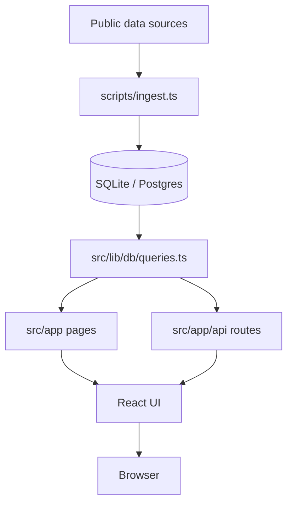

# India in the World — Global Progress Dashboard

[](https://nextjs.org)
[](https://react.dev)
[](https://www.typescriptlang.org)
[](https://tailwindcss.com)


> A live dashboard tracking India's standing across ~120 global indicators
> (economy, health, education, environment, governance, technology, equality, safety,
> digital government), sourced from trusted public datasets — World Bank, WHO, UNDP,
> OWID, WGI, Transparency International, Numbeo, and ~30 more.

Built for the **Development Challenge 2026**. Designed as a real product, not a
hackathon demo — clean data, clean code, shippable today.

---

## Overview

**What it does:** aggregates India's global rankings across ~120 indicators into one
queryable, visual surface with trend charts, world maps, country profiles, rankings,
report cards, and an AI chatbot with citations.

**Problem solved:** no single free place consolidates India's global rankings with
consistent definitions, history, and comparisons.

**Audience:** citizens, journalists, researchers, policymakers, developers, contributors.

**Value proposition:** one indicator registry drives both ingestion and UI; auto-detecting
DB driver (SQLite local / Postgres remote); server components first; free-first stack.

## Features

**Core**
- 121 registered indicators across 10 categories; ~105k data points; 217 countries; 34 sources.
- Auto-detecting DB driver (SQLite local / Supabase PG remote).

**User-facing**
- Home: 12 KPI cards with trend arrows, 4 multi-country trend charts, D3 world map, scatter correlation, GDP leaderboard.
- Explore: category filter + search with data coverage.
- Indicator detail: India snapshot, global rank, trend, guide, chart, historical events, top-10, related.
- Country profile: score/grade, radar vs India, top/bottom performers, trend vs India.
- Compare: multi-country line/bar/radar, deltas, table, AI insight.
- Rankings: sortable world table, India rank-over-time.
- Report card: A–F grade, per-category scores, India-vs-China radar, Print/PDF + CSV export.
- Methodology page.
- AI chat with citations.

**Technical**
- Server components first; client components for interactivity.
- Local TF-IDF search (no API key).
- Groq RAG chat with citations.
- D3 choropleth world map with year/indicator selectors.
- Scatter correlation with Pearson r.

**Security**
- None implemented (no auth). See [docs/15](./docs/15-security-documentation.md).

**Status labels**
- ✅ Implemented: all pages/APIs above.
- ⏳ Planned: authentication/users, production PG DB.
- ⚠️ Blocked: production DB (original Supabase host dead).

## Technology stack

| Layer | Technology |
|---|---|
| Framework | Next.js 16 (App Router) |
| UI | React 19, Tailwind 4, shadcn/ui (base-ui) |
| Charts | Recharts 3, D3 (d3-geo, d3-scale) |
| Language | TypeScript 5 (strict) |
| DB (local) | node:sqlite |
| DB (remote) | pg (Supabase Postgres) |
| AI | Groq (LLM), HuggingFace (optional embeddings), local TF-IDF |
| Testing | Vitest 4, Playwright 1.63 |
| Tooling | tsx, ESLint 9, Vercel CLI |

Full details: [docs/02](./docs/02-technology-stack.md).

## Architecture overview

Monolithic full-stack Next.js app: pages (server components) → `src/lib/db/queries.ts` →
auto-detecting client → SQLite/Postgres. Ingestion pipeline (`scripts/`) populates DB from
public sources. AI chat uses TF-IDF over an `embeddings` table plus Groq.



Details: [docs/04](./docs/04-system-architecture.md).

## Project structure

```
india-dashboard/
├── src/
│   ├── app/            # pages + API routes
│   ├── components/     # ui + dashboard widgets
│   └── lib/            # db, data, ai, helpers
├── scripts/            # ingest, index-embeddings, status
├── e2e/                # Playwright tests
├── data/               # SQLite (gitignored)
├── docs/               # documentation
└── public/             # static assets
```

Details: [docs/03](./docs/03-project-structure.md).

## Prerequisites

- Node.js 20+ (22+ for `node:sqlite`).
- npm.
- (Optional) Groq API key, HuggingFace token.

## Installation and setup

```bash
npm install
cp .env.example .env
# set GROQ_API_KEY (optional); leave DATABASE_URL commented for SQLite
npm run ingest
npm run status          # optional verify
npm run index-embeddings # optional
npm run dev             # http://localhost:3000
```

Production build: `npm run build && npm start`.

Full steps: [docs/11](./docs/11-installation-and-setup.md).

## Environment variables

| Variable | Required | Purpose | Default |
|---|---|---|---|
| `DATABASE_PATH` | No | SQLite file path | `./data/india.db` |
| `DATABASE_URL` | No | Postgres connection (switches driver) | unset (SQLite) |
| `GROQ_API_KEY` | No* | Groq LLM for chat/insights | unset → chat returns null |
| `HF_API_KEY` | No | HuggingFace embeddings | unset → disabled |

\* Required for AI features, but app runs without.

Full: [docs/10](./docs/10-configuration-and-environment.md).

## Running the application

- Dev: `npm run dev`
- Build: `npm run build`
- Start (prod): `npm start`
- Lint: `npm run lint`
- Tests: `npm test`
- Ingest: `npm run ingest` / `npm run ingest:new`
- Index embeddings: `npm run index-embeddings`
- Status: `npm run status`

## API documentation

Routes: `/api/scatter`, `/api/rankings`, `/api/indicators/series`, `/api/indicators/leaderboard`,
`/api/ai/insights`, `/api/ai/chat`. No OpenAPI spec. Details: [docs/08](./docs/08-api-documentation.md).

## Database

SQLite locally (`data/india.db`), optional Supabase PG via `DATABASE_URL`. Schema in
`src/lib/db/client.ts`. Details: [docs/07](./docs/07-database-documentation.md).

## Testing

- Unit: `npm test` (Vitest) — 41 tests across 6 files.
- E2E: Playwright (dev server on port 3456 must be running). Details: [docs/13](./docs/13-testing-and-quality.md).

## Deployment

Vercel serverless. SQLite not viable in prod; needs live PG. Original Supabase host is
dead — production blocked until replaced. Details: [docs/14](./docs/14-deployment-and-infrastructure.md).

⚠️ **Deployment status:** original Supabase PG host is dead (DNS ENOTFOUND); Vercel env
vars likely still point at it → deployed pages 500. Local dev unaffected. See
[AGENTS.md](./AGENTS.md).

## Documentation

Index: [docs/README.md](./docs/README.md). All documents under `docs/`.

## Contributing

- Follow conventions in [docs/12](./docs/12-development-guide.md).
- Run `npm test` and `npm run build` before submitting.
- Don't commit secrets or `.env`.
- Proposed guidelines (no existing CONTRIBUTING file) — treat as proposed.

## License

No LICENSE file is present in the repository; the license has not yet been specified.
(README previously mentioned "MIT" in prose, but no LICENSE file exists to verify this.)

## Acknowledgements

Next.js, React, Tailwind, shadcn/ui, Recharts, D3, World Bank, WHO, UNDP, OWID, and other
public data providers.

## Contact and support

Repository: (use actual repo link when available). No contact info verified in repo.
